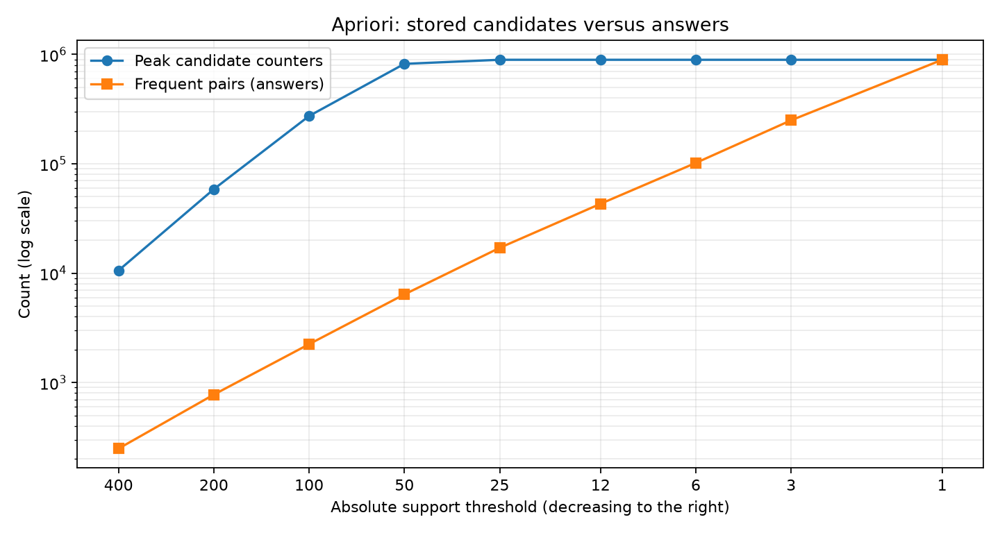

# Task 2: 지지도를 낮출 때 후보와 정답 수의 변화

측정일: 2026-10-22, 한국 시간. CPU: AMD Ryzen 7 260 w/ Radeon 780M Graphics. RAM: 33,591,296,000 bytes (31.28 GiB). Windows 11, Python 3.12.14. Chrome, Codex/ChatGPT가 실행 중이었으며 백그라운드 부하는 통제하지 않았다. 시간은 단일 실행이므로 변동이 있다.

## A1·A3·A5: 기본 데이터의 완료된 실측

교수님 bench.build(seed=246)의 상품 2,000개, 장바구니 20,000개를 사용했다. 지지도는 비율이 아닌 최소 등장 장바구니 수다. 아래 결과는 모두 끝까지 계산한 값이며, 확장 중단 실험과 섞지 않았다.

| 지지도 | 후보 카운터 peak | 빈발 쌍(정답) | 시간(초) | 추적 peak(MiB) |
|---:|---:|---:|---:|---:|
| 400 | 10,585 | 249 | 0.557 | 1.01 |
| 200 | 58,626 | 776 | 1.105 | 6.09 |
| 100 | 273,701 | 2,244 | 1.945 | 25.17 |
| 50 | 820,259 | 6,397 | 4.250 | 97.44 |
| 25 | 893,456 | 17,045 | 4.851 | 97.44 |
| 12 | 893,456 | 43,116 | 5.685 | 97.96 |
| 6 | 893,456 | 101,938 | 6.361 | 113.83 |
| 3 | 893,456 | 250,054 | 6.773 | 149.34 |
| 1 | 893,456 | 893,456 | 7.879 | 311.87 |



9개 지지도로 최대/최소 400배 범위를 측정했다. 그래프는 가로·세로 로그 축이며 오른쪽으로 갈수록 지지도가 낮다.

## A4: 실제 증가 배율

| 지지도 변화 | 후보 카운터 배율 | 정답 쌍 배율 |
|---|---:|---:|
| 400 → 200 | 5.539 | 3.116 |
| 200 → 100 | 4.669 | 2.892 |
| 100 → 50 | 2.997 | 2.851 |
| 50 → 25 | 1.089 | 2.665 |
| 25 → 12 | 1.000 | 2.530 |
| 12 → 6 | 1.000 | 2.364 |
| 6 → 3 | 1.000 | 2.453 |
| 3 → 1 | 1.000 | 3.573 |

400→200→100→50에서 후보 카운터는 약 5.54배, 4.67배, 3.00배로 늘어 단순한 두 배 증가보다 컸다. 400→50 전체로는 후보가 약 77.49배 증가했지만 정답은 약 25.69배 증가했다. 특히 support=50에서는 820,259개의 후보 카운터를 저장해 6,397개의 정답만 얻었다.
25 이하에서는 후보가 893,456개로 포화되었다. 관측 가능한 상품 쌍은 유한하며 임계값을 더 낮춰도 새로 세어야 할 관측 쌍이 늘지 않기 때문이다. 이 구간의 정답은 17,045→893,456개로 계속 증가하므로 과제 설명의 '카운터는 계속 폭증하고 정답은 천천히 증가한다'가 모든 구간에서 맞지는 않았다. 낮은 지지도에서는 결과 사전 자체도 커져, 후보 수가 같아도 peak bytes는 증가했다. 입력 크기와 분포를 고정한 실측의 한계를 숨기지 않았다.

## A2: 실제 중단 지점과 확장 실험

기본 데이터는 support=1에서도 완료됐다. 이 PC에서 기본 데이터의 메모리 고갈이나 실행 불능을 관측했다고 주장할 수 없다. 상품 2,000개면 가능한 쌍의 이론적 상한도 1,999,000개이므로 고정 데이터에서 임계값만 계속 낮춰 무한히 폭증시킬 수 없다.
별도로 상품 20,000개·장바구니 50,000개·평균 추출 수 60·Zipf 지수 0.8·seed 246의 확장 데이터를 만들었다. 생성 시 누적 가중치를 재사용하며 planted pair를 추가하지 않아 기본 데이터와 다른 보충 실험이다. Apriori의 빈발 상품 필터 후 두 번째 단계의 정확한 카운팅을 수행했다.
support=3에서 12,352/50,000개 장바구니를 처리한 뒤 50.20초, 후보 11,220,932개, 추적 peak 1557.36 MiB에서 중단했다. 중단 사유는 1 GiB traced-allocation safety limit이다.
사전에 60초 대기 또는 추적 할당 1GiB를 중단 기준으로 정하고 64개 장바구니마다 확인했다. 사전의 크기 확장과 검사 간격 때문에 실제 peak는 1GiB를 초과했다. 이는 엄격한 메모리 상한이나 PC 전체 RAM 고갈이 아니라 실행을 계속하지 않기 위한 작업 예산이다. 확장 실험의 카운터 수는 처리한 부분까지의 관측값으로 최종 peak의 하한이며, 빈발 쌍 정답은 완성하지 않았다. stress_limit.json의 completed=false로 명시했다. 이 시간은 입력 생성과 1차 패스를 제외한 2차 패스만이다.

## Task 3 R5: 버킷 비용까지 포함한 실제 메모리

1,048,576개 버킷을 unsigned 32-bit array로 보관한다. 실제 array 크기는 4,194,384 bytes(헤더 포함), 변환 후 비트맵은 131,129 bytes(헤더 포함)다. 비트맵을 만드는 순간에는 배열과 비트맵이 함께 존재한다. 전체 버킷 배열과 단일 상품 카운터는 두 번째 패스 전에 del로 해제한다.
peak_counters는 후보 쌍별 카운터만을 센 점수 지표다. 1차 패스의 1,048,576개 버킷 카운터까지 포함한 전체 정수 개수가 기준보다 작다는 주장은 하지 않았다. 촘촘한 배열의 정수와 Python 사전의 쌍 카운터는 개당 비용이 다르므로 실제 추적 peak도 따로 비교했다.

| 장바구니 수 | Apriori 후보 peak | PCY 후보 peak | Apriori peak(MiB) | PCY peak(MiB) |
|---:|---:|---:|---:|---:|
| 500 | 136 | 12 | 0.106 | 4.382 |
| 2,000 | 6,228 | 181 | 0.688 | 4.336 |
| 5,000 | 50,168 | 904 | 6.081 | 4.360 |
| 20,000 | 820,259 | 12,881 | 97.443 | 4.461 |

모든 행은 support=50, 같은 20,000개 데이터의 앞부분을 사용했으며 정답뿐 아니라 각 쌍의 등장 횟수까지 일치했다. 2,000개에서는 고정 배열 비용 때문에 PCY가 더 컸고, 5,000개에서는 PCY가 더 작았다. 따라서 이 분포·버킷 수·support에서 관측한 교차 구간은 2,000–5,000개 장바구니 사이이며 정확한 교차점이나 다른 데이터에 대한 보편 임계값은 아니다.
버킷을 16,384개로 줄이자 16,384개 모두 frequent가 되었고 후보 카운터가 820,259개로 기준과 같아졌다. 배열은 작아졌지만 충돌 때문에 필터가 아무 후보도 거르지 못했다. 반면 기본 버킷 수에서는 6,946개 버킷만 통과하고 후보는 12,881개였다.
기본 데이터에서 추적 peak는 Apriori 97.443 MiB, PCY 4.461 MiB로 실제로도 절약됐다. 하지만 bench.py의 비추적 시간은 1.58초 대 3.99초로 PCY가 느렸다. 이 과제는 시간보다 peak 카운터를 점수화하며, 해시 계산과 추가 필터링 비용이 생긴다.

## 측정 범위와 재현

기본 Task 2 시간은 PlainApriori.run 전체다. tracemalloc은 알고리즘 실행 중 추적한 할당의 peak로 입력 장바구니 생성, 전체 프로세스 메모리, 전체 PC RAM과 다르다. 반환 결과 사전의 생성은 포함된다. memory_crossover.json은 별도 추적 실행이고 bench.txt는 추적 없는 성능 평가이므로 두 실행의 시간을 혼동하지 않는다. bench.py·test_tasks.py·PlainApriori는 원본을 유지했다.

```text
python task2_explosion.py --supports 400,200,100,50,25,12,6,3,1
python extra_experiments.py
python stress_limit.py
python write_report.py
```

write_report.py는 그림 생성에 matplotlib을 사용한다. 핵심 구현과 교수님 검사는 Python 기본 라이브러리만 사용한다. 재실행한 측정은 explosion.json에 추가되므로 보고서 작성에 쓰는 실행을 구분한다.
