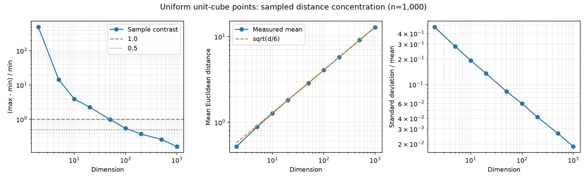

# Task 2: 차원에 따른 거리 집중 실험

측정일: 2026-10-31 (한국 시간). CPU: AMD Ryzen 7 260 w/ Radeon 780M Graphics. RAM: 33,591,296,000 bytes (31.28 GiB). Windows 11, Python 3.12.14. Codex/ChatGPT, Chrome, Defender, Explorer가 실행 중이었고 백그라운드 부하는 통제하지 않았다. 시간은 단일 실행값이다.

## A1·A2·A3·A5: 차원별 측정

각 차원에서 단위 초입방체 [0,1]^d의 균등 점 1,000개를 생성했다. 최대 20,000번 점 쌍을 무작위로 뽑고 자기 자신인 쌍은 제외한다. 같은 쌍의 중복 추출은 허용하므로 아래 pairs는 서로 다른 쌍의 수가 아니다. min/max는 표본 극값이며 전체 점 쌍의 최근접·최원거리와 다르다.

| 차원 d | 유효 pairs | min | max | mean | 표준편차 | contrast | 상대 표준편차 | 시간(초) |
|---:|---:|---:|---:|---:|---:|---:|---:|---:|
| 2 | 19,978 | 0.00271 | 1.32554 | 0.52103 | 0.24794 | 488.58160 | 0.47587 | 0.0274 |
| 5 | 19,977 | 0.11060 | 1.68738 | 0.88425 | 0.24899 | 14.25663 | 0.28158 | 0.0366 |
| 10 | 19,977 | 0.43845 | 2.15946 | 1.27354 | 0.24540 | 3.92518 | 0.19269 | 0.0418 |
| 20 | 19,981 | 0.82081 | 2.66989 | 1.81529 | 0.24539 | 2.25274 | 0.13518 | 0.0697 |
| 50 | 19,977 | 1.90919 | 3.78485 | 2.86728 | 0.23795 | 0.98244 | 0.08299 | 0.1301 |
| 100 | 19,974 | 3.20575 | 4.95354 | 4.06810 | 0.24319 | 0.54520 | 0.05978 | 0.4174 |
| 200 | 19,980 | 4.87087 | 6.68184 | 5.77612 | 0.23906 | 0.37179 | 0.04139 | 0.5793 |
| 500 | 19,985 | 8.01327 | 10.07252 | 9.11868 | 0.24226 | 0.25698 | 0.02657 | 1.1887 |
| 1000 | 19,984 | 11.91343 | 13.81456 | 12.90346 | 0.23963 | 0.15958 | 0.01857 | 2.3550 |



측정한 차원 중 contrast<1이 처음 관측된 것은 d=50 (0.98244), <0.5는 d=200 (0.37179)다. 따라서 시험한 점 사이의 첫 통과 구간은 각각 20–50차원, 100–200차원이다. 정확한 전환 차원이나 전체 점 쌍의 전환점을 측정한 것은 아니며, 특히 50차원 값은 1에 가깝다.
상대 표준편차도 약 0.476→0.019로 감소했다. 보통 거리들의 전반적 집중을 보려면 표본 극값과 표본 수에 민감한 contrast보다 상대 표준편차가 더 안정적이라고 판단했다. 다만 실제 최근접·최원거리의 격차가 목적이면 contrast도 유용하다. 어느 하나만으로 '모든 거리 기반 알고리즘이 무의미하다'고 결론 낼 수는 없다.

## A4: 평균 거리는 d가 아니라 sqrt(d)에 가깝게 증가

| d | 실측 mean | sqrt(d/6) | mean/sqrt(d) |
|---:|---:|---:|---:|
| 2 | 0.52103 | 0.57735 | 0.36842 |
| 5 | 0.88425 | 0.91287 | 0.39545 |
| 10 | 1.27354 | 1.29099 | 0.40273 |
| 20 | 1.81529 | 1.82574 | 0.40591 |
| 50 | 2.86728 | 2.88675 | 0.40549 |
| 100 | 4.06810 | 4.08248 | 0.40681 |
| 200 | 5.77612 | 5.77350 | 0.40843 |
| 500 | 9.11868 | 9.12871 | 0.40780 |
| 1000 | 12.90346 | 12.90994 | 0.40804 |

독립 균등 좌표 X,Y에서 E[(X−Y)^2]=1/6이므로 E[D²]=d/6이다. 이것은 E[D]=sqrt(d/6)와 정확히 같다는 뜻은 아니지만, 큰 d에서 D가 집중하므로 평균도 그 값에 가까워진다. mean/sqrt(d)는 고차원에서 약 0.408로 안정되어 1/sqrt(6)≈0.40825와 맞는다. 예를 들어 d=200→1000은 5배인데 평균은 약 2.23배로 sqrt(5)≈2.236에 가깝고 선형 5배가 아니다.

## A6: 같은 차원에서 점 개수 바꾸기

50차원, 최대 20,000번 추출이라는 표본 예산을 고정한 기본 코드의 결과다. 점 생성 뒤 같은 RNG로 쌍을 뽑으므로 n이 바뀌면 쌍 표본도 바뀐다.

| n | 표본 pairs | contrast | 상대 표준편차 |
|---:|---:|---:|---:|
| 100 | 19,798 | 0.81109 | 0.08121 |
| 500 | 19,955 | 0.92752 | 0.08194 |
| 1,000 | 19,977 | 0.98244 | 0.08299 |
| 2,000 | 19,989 | 1.02210 | 0.08250 |
| 5,000 | 19,997 | 0.87656 | 0.08360 |

표본 contrast는 약 0.811, 0.928, 0.982, 1.022, 0.877로 변해 n에 대해 단조 증가하지 않았다. 이를 'n의 영향이 없다'고 결론 내릴 수는 없다. 고정 개수의 무작위 쌍은 전체 극값을 보장하지 않기 때문이다.
추가로 동일한 1,000개 점에서 앞의 100·300·1,000개를 중첩 부분집합으로 사용해 모든 서로 다른 점 쌍을 계산했다.

| n | 전체 pairs | 전체 contrast | 상대 표준편차 | 시간(초) |
|---:|---:|---:|---:|---:|
| 100 | 4,950 | 0.81109 | 0.08071 | 0.0294 |
| 300 | 44,850 | 1.02112 | 0.08195 | 0.2597 |
| 1,000 | 499,500 | 1.30609 | 0.08288 | 2.9129 |

중첩 입력의 전체 쌍에서는 점을 추가해도 최소 거리가 커지거나 최대 거리가 작아질 수 없으므로 contrast가 감소하지 않는다. 실측도 0.811→1.021→1.306으로 증가했다. 특히 같은 d=50,n=1,000에서도 전체 contrast=1.306은 표본값 0.982와 다르므로 A3의 50차원 통과를 전체 극값의 보편 경계로 해석하면 안 된다.

## A7: 가장 큰 차원의 실행 시간

기본 차원 실험의 최대 d=1,000,n=1,000은 2.3550초 걸렸다. 이 시간에는 점 생성과 표본 거리 계산이 포함되고 그 뒤의 요약 통계 계산은 제외된다. 보충 전체 쌍 실험의 최대 n=1,000,d=50,499,500쌍은 2.9129초였다. 두 실험의 작업량은 서로 다르다.

## A8: 3주차 Jaccard LSH에도 그대로 적용되는가?

이번 결과는 균등한 독립 유클리드 좌표의 실험이다. 문서 shingle 집합의 Jaccard 유사도나 실제 문서 분포가 같다는 근거는 아니므로 이 수치만으로 3주차 LSH가 실패한다고 할 수 없다. MinHash의 일치 확률과 Jaccard 사이의 관계, 밴딩 후보 확률도 이 유클리드 차원 증가만으로 깨지지 않는다.
다만 실제 문서에서도 의미 있는 쌍과 무관한 쌍의 유사도가 비슷하게 몰리면 LSH의 후보 분리가 어려워질 수 있다. 중요한 것은 해당 데이터에서 Jaccard 분포와 유사/비유사 쌍의 격차다. 3주차에서는 심은 근접 중복과 다른 문서의 격차가 있었으므로 별도의 관측으로 평가해야 한다.

## 재현

```text
python task2_curse.py --dims 2,5,10,20,50,100,200,500,1000
python task2_curse.py --dims 50 --points 100
python task2_curse.py --dims 50 --points 500
python task2_curse.py --dims 50 --points 2000
python task2_curse.py --dims 50 --points 5000
python extra_experiments.py
python write_report.py
```

curse.json은 실행 결과를 추가한다. 보고서 재생성 전 기존 실행과 재측정을 구분해야 한다. 핵심 구현과 검사는 표준 라이브러리만 사용하며 write_report.py의 그래프 생성만 matplotlib이 필요하다.
